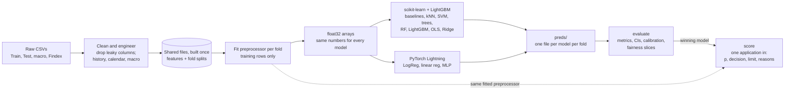

# Prosit 2: Responsible Credit Scoring for NkwaPay

ICS553 Machine Learning Essentials · Group 2

We train a default model and a loan-amount model on Kenyan loans, test how well they transfer to Ghana, audit them for fairness and regulation, and ship a small scoring service. Everyone works from **one shared pipeline, one preprocessed dataset and one evaluation script**, so every result is comparable.

## Contents

- [Status](#status)
- [Roadmap](#roadmap)
- [Team](#team)
- [Getting started](#getting-started)
- [1. Understand the data](#1-understand-the-data)
- [2. Framework](#2-framework-pytorch-lightning-plus-scikit-learn)
- [3. Keywords](#3-keywords)
- [4. The shared pipeline](#4-the-shared-pipeline)
- [5. Models and who owns them](#5-models-and-who-owns-them)
- [6. Training, evaluation and inference](#6-training-evaluation-and-inference)
- [7. Who does what](#7-who-does-what)
- [8. Team rules](#8-team-rules)

## Status

| Notebook | Purpose | Owner | Status |
| --- | --- | --- | --- |
| `01_eda.ipynb` | Explore and clean the data; build features and fold splits | Person 1 | ⬜ Not started |
| `02_classification.ipynb` | Default model: validation study, calibration, cost threshold, CIs | Person 2 | ⬜ Not started |
| `03_regression.ipynb` | Loan-amount model, residuals, scoring service | Person 3 | ⬜ Not started |
| `04_transfer_and_fairness.ipynb` | Kenya → Ghana shift, fairness, Model Card, regulation | Person 4 | ⬜ Not started |

Status key: ⬜ Not started · 🟨 In progress · ✅ Done

## Roadmap

**Live progress: [Roadmap issue #1](https://github.com/ASU-MICS-2028/mle-group-2-prosit-2/issues/1).** Every task is an issue; its progress bar updates on its own as issues close. To close a task, open a pull request whose description says `Closes #<issue number>`.

Tick a phase below when all its issues are closed. `P1`–`P4` are the roles in [section 7](#7-who-does-what).

- [ ] **Setup** · [#2](https://github.com/ASU-MICS-2028/mle-group-2-prosit-2/issues/2) ✅ datasets profiled, [#3](https://github.com/ASU-MICS-2028/mle-group-2-prosit-2/issues/3) roles, [#4](https://github.com/ASU-MICS-2028/mle-group-2-prosit-2/issues/4) repo skeleton
- [ ] **Part A: Frame the problem** · parallel exploration (#5–#8), Part A session (#9), tasks and goal (#10), cost matrix (#11)
- [ ] **Part B: Build and evaluate** · shared features and scripts (#12–#13), validation study (#14), models (#15–#18), calibration and CIs (#19–#20), regression metrics (#21), interpretation (#22)
- [ ] **Part C: Cross-market transfer** · Kenya vs Ghana shift (#23), trust evidence (#24)
- [ ] **Part D: Ethical and regulatory audit** · Model Card (#25), fairness (#26), regulation (#27), Findex (#28), decline explanation (#29)
- [ ] **Part E: Make it deployable** · scoring service (#30), latency and inputs (#31)
- [ ] **Deliverables** · derivations (#32), clean-clone reruns (#33), report (#34), audit (#35), slides and Q&A (#36), reflections (#37)

Filter issues by role: [P1](https://github.com/ASU-MICS-2028/mle-group-2-prosit-2/issues?q=is%3Aissue+label%3AP1) · [P2](https://github.com/ASU-MICS-2028/mle-group-2-prosit-2/issues?q=is%3Aissue+label%3AP2) · [P3](https://github.com/ASU-MICS-2028/mle-group-2-prosit-2/issues?q=is%3Aissue+label%3AP3) · [P4](https://github.com/ASU-MICS-2028/mle-group-2-prosit-2/issues?q=is%3Aissue+label%3AP4) · [whole team](https://github.com/ASU-MICS-2028/mle-group-2-prosit-2/issues?q=is%3Aissue+label%3Aall)

## Team

| Role | Name | Focus |
| --- | --- | --- |
| P1 · Data and features | _TBD_ | Prepares the data everyone else uses |
| P2 · Classification and evaluation | _TBD_ | Builds the shared training and testing tools; sets the approve/decline rule |
| P3 · Regression and deployment | _TBD_ | Predicts how much to lend; builds the scorer |
| P4 · Transfer and fairness | _TBD_ | Checks the model works for Ghana and treats every group fairly |

## Getting started

1. Clone the repo and create the environment (requirements to be added by P1).
2. Download the three zips and unzip them into `data/raw/` (never commit data):
   - `african-credit-scoring-challenge` from [Zindi](https://zindi.africa/competitions/african-credit-scoring-challenge)
   - `GHA_2021_FINDEX_v02_M_csv` from the [World Bank Microdata Library](https://microdata.worldbank.org/index.php/catalog/4646)
   - `financial-inclusion-in-africa` from Zindi (optional)
3. Run the notebooks in order, `01` to `04`.

Planned layout:

```text
data/raw/          the unzipped datasets (git-ignored)
data/processed/    shared features file and fold splits, built once by P1
artifacts/         fitted preprocessor, models, calibrators
preds/             one predictions file per model per fold
src/               shared code: loading, features, splits, preprocessing, DataModule, train, evaluate, score
notebooks/         01_eda, 02_classification, 03_regression, 04_transfer_and_fairness
```

---

## 1. Understand the data

**Only the credit-scoring zip is used to train models. The two survey zips describe who has access to finance, and feed the fairness work.** All figures below were measured on the downloaded files.

### The three zips

| Zip | Files inside | Role for us |
| --- | --- | --- |
| african-credit-scoring-challenge | Train.csv (68,654 × 16), Test.csv (18,594 × 15), economic_indicators.csv (27 × 25), SampleSubmission.csv, VariableDefinitions.txt, starter notebook, manifest (ignore) | Everything we model |
| GHA_2021_FINDEX_v02_M_csv | micro_gha.csv (1,000 × 120) | Part D: who in Ghana lacks credit; gender and urban/rural, which the loan data lacks |
| financial-inclusion-in-africa | Train.csv (23,524 × 13), Test.csv (10,086 × 12), VariableDefinitions.csv, SampleSubmission.csv, starter notebook | The brief's fallback inclusion data; East Africa only, optional |

### Train.csv and Test.csv: one row = one lender's share of one loan

**Train** is all Kenya, October 2021 to November 2024: 6,540 customers with a median of 6 loans each (max 208), and 1,258 defaults (1.83%). **Test** has 15,069 Kenyan and 3,525 Ghanaian rows; Ghana's run only from November 2021 to March 2023. Neither file has missing values. Test has every column except `target`.

| Column | Meaning | What the data shows | Use |
| --- | --- | --- | --- |
| ID | customer + loan + lender ids | Unique | Submission key |
| customer_id | Borrower | 4,306 also in Test | Group key, history |
| country_id | Kenya / Ghana | Train all Kenya | Fairness slice |
| tbl_loan_id | Loan | 2,134 two-lender loans appear twice; 920 in Test | De-duplicate; drop |
| lender_id | Funding lender | 4 in Train (one has 94%); 4 new in Test | Feature + "unseen"; slice |
| loan_type | Product | 22 types, Type_1 = 90%; Type_3 and Type_8 only in Test | Feature + "unseen"; slice |
| Total_Amount | Principal, local currency | Median 5,249 (Ghana 3,002); max 23M | **Task 1 target**; feature |
| Total_Amount_to_Repay | Principal + interest + fees | Markup 0.8% repaid vs 22% defaulted | **Leak suspect: drop** |
| disbursement_date | Money sent | 94% in 2022 | Time anchor; splits |
| due_date | Repayment due | = disbursement + duration | Redundant; drop |
| duration | Term, days | 7 days for 95% | Feature |
| New_versus_Repeat | First or repeat loan | 99.2% repeat; default 21% new vs 1.7% | Feature; slice |
| Amount_Funded_By_Lender | Lender's amount | = Total_Amount × portion | Redundant |
| Lender_portion_Funded | Lender's share, 0–1 | Median 0.30 | Feature |
| Lender_portion_to_be_repaid | Lender's share owed | Owed ÷ funded: 1.01 repaid vs 1.28 defaulted | **Leak suspect: drop** |
| target | 1 defaulted, 0 repaid | 1,258 defaults (1.83%) | **Task 2 label** |

Default rate ranges from 1.2% to 41% across lenders and from 0.8% (Type_1) to 72% (Type_14) across loan types.

**The leak, from first principles.** Rank loans by one column alone and measure how well that ranking separates defaulters (AUC: 0.5 = no signal, 1.0 = perfect). The two repayment columns score **0.98** each; the loan amount scores 0.62. A single column that nearly predicts the label is almost always recording the outcome, here most likely late penalties added after a default. Unless the data owner confirms these amounts are fixed at issuance, drop both.

**Two more warnings.** Default rates drift sharply by year (1.3% in 2022, 11.5% in 2023, 8.7% in 2024), so random splits will mislead and the temporal split matters. Kenyan amounts are in shillings and Ghanaian in cedis, so convert to USD with the exchange rate below before comparing countries.

### economic_indicators.csv: one row = one indicator for one country

27 rows (Ghana, Côte d'Ivoire, Kenya × 9 indicators), one column per year from YR2001 to YR2023. The indicators: inflation, official exchange rate (local currency per USD), real interest rate, deposit rate, lending rate, interest rate spread, unemployment, precipitation and fossil-fuel use.

- **Gaps:** Ghana has no lending rate, real interest rate or spread; precipitation stops at 2021; fossil-fuel use is empty for both countries.
- **Signal:** Ghana's inflation was 31% in 2022 and 38% in 2023, against Kenya's 7.7%, a major source of shift.
- **Use:** reshape to one row per country-year, join each loan to the **previous** year's values (annual figures are published after year-end), and use the exchange rate to convert amounts to USD.

### SampleSubmission.csv

The Zindi format: ID plus a 0/1 target for each of the 18,594 Test rows. It requires a hard decision, which is why the competition scores F1. The brief calls the key TransactionId; the file uses ID.

### micro_gha.csv (Findex Ghana 2021): one row = one surveyed adult

1,000 adults and 120 columns. Use the weight column **wgt** for any population figure. Most `fin*` columns are survey questions with skip logic, so blanks mean "not asked"; check the Findex codebook before using them. Yes/no questions are coded 1 = yes, 2 = no, 3–4 = don't know or refused.

| Column | Meaning |
| --- | --- |
| female | 1 = female, 2 = male |
| age, educ | Age; education (1 primary or less, 2 secondary, 3 tertiary) |
| inc_q, emp_in | Income quintile (1 poorest to 5 richest); in the workforce (1 = yes) |
| urbanicity_f2f | 1 = rural, 2 = urban |
| account, account_fin, account_mob | Has any account / a financial-institution account / a mobile money account (1 = yes) |
| borrowed, fin22a | Borrowed from any source / from a formal financial institution in the past year |
| saved, mobileowner, internetaccess, anydigpayment | Saving, phone ownership, internet access, digital payments |

What it already says (weighted):

| Group | Has an account | Mobile money account | Borrowed formally |
| --- | --- | --- | --- |
| All adults | 68% | 60% | 7.2% |
| Women / men | 63% / 74% | 55% / 65% | 5.6% / 9.0% |
| Rural / urban | 57% / 76% | 48% / 68% | 6.6% / 7.7% |
| Poorest 40% / richest 60% | 55% / 77% | 46% / 69% | 4.9% / 8.8% |

Only 7% of Ghanaian adults borrow formally, and women, rural and poorer adults have less access. Our model learns only from people who already borrow digitally, so it says nothing about the excluded.

### Financial Inclusion in Africa: one row = one surveyed adult

23,524 adults in Train (Rwanda 8,735, Tanzania 6,620, Kenya 6,068, Uganda 2,101; 2016–2018). The target `bank_account` is "Yes" for 14.1% (25% in Kenya). Its 13 columns: country, year, uniqueid, bank_account, location_type, cellphone_access, household_size, age_of_respondent, gender_of_respondent, relationship_with_head, marital_status, education_level, job_type. It has no Ghana and no loan outcomes, so treat it as optional Kenya-side context.

### How we explore: in parallel, then decide together

**Everyone explores one slice of the data, the group decides together, and P1 turns the decisions into the one shared file.** Everyone ends up understanding the whole dataset, and there is still only one cleaned version.

| Who | Explores | Questions to answer |
| --- | --- | --- |
| P1 | Train/Test structure | How to merge the 2,134 two-lender loans? How to treat the 4,306 customers and 920 loans in both files? Any duplicates or odd values? |
| P2 | The target | How does the default rate move by month, lender, loan type and tenure? How much does random vs customer vs time splitting change it? |
| P3 | Amounts and durations | How skewed are amounts? Are the two leak suspects fixed at issuance or recorded after default? |
| P4 | Ghana and the context files | How do Ghana's lenders, loan types, amounts (in USD) and durations differ from Kenya's? What do the macro, Findex and inclusion files add? |

1. **Days 1–2: explore.** Each person works on their slice and brings 3–5 findings with one chart each.
2. **Part A session: decide.** Each person presents their slice in about 10 minutes. The group then agrees on the leakage rulings, the columns to drop, how overlapping customers are handled, and how unseen lenders and loan types are scored.
3. **Days 2–3: implement.** P1 builds the shared feature file and fold splits from those decisions. Until then, everyone models on the rough file from the safe columns.

## 2. Framework: PyTorch Lightning plus scikit-learn

**Decision: PyTorch Lightning for the neural models, scikit-learn and LightGBM for the rest, all fed by the same preprocessed arrays.** Lightning cannot train decision trees, kNN, SVMs or gradient boosting, and the brief requires at least five syllabus models including those.

With about 68,654 rows by 30 columns (around 16 MB), everything fits on a laptop, so Lightning's speed and memory benefits barely matter. Its value here is **structure**: every neural model shares one training loop, logging and checkpointing, so four people can swap models freely. On tabular data gradient boosting usually beats neural nets, and the committee prefers simple models, so expect logistic regression or LightGBM to win, with the MLP as a comparison.

| Tool | Use it for |
| --- | --- |
| pandas | Loading, cleaning, borrower history |
| scikit-learn | Preprocessing, splits, kNN, SVM, trees, Random Forest, metrics, calibration |
| LightGBM | Gradient boosting, Task 1 and 2 |
| PyTorch Lightning | Logistic regression, linear regression, MLP |
| shap, joblib | Reason codes; saving the preprocessor and models |

### Lightning in four pieces

| Piece | What it does |
| --- | --- |
| DataModule | Owns the data: hands batches of a fold's arrays to the model |
| LightningModule | Owns the model: layers, loss, one training step, optimizer |
| Trainer | Runs the loop: epochs, devices, logging |
| Callbacks | Plug-ins such as early stopping and checkpointing |

## 3. Keywords

### Data

| Term | Meaning | Term | Meaning |
| --- | --- | --- | --- |
| Sample / row | One example; here, one loan | Feature | An input the model sees |
| Label / target | The answer to predict | Class imbalance | One class is rare (defaults: 1.83%) |
| Leakage | Using information not available at decision time | Cardinality | Number of distinct values in a column |
| Imputation | Filling missing values | One-hot encoding | A category turned into 0/1 columns |
| Log transform | log(1 + x); tames long money tails | Normalization | (x − mean) / std, using training data only |
| Denormalization | Converting a model output back to cedis | Domain shift | Ghana's population differs from Kenya's |

### Splitting and training

| Term | Meaning | Term | Meaning |
| --- | --- | --- | --- |
| Train / val / test | Learn, tune, report once | Cross-validation | Rotate the validation slice k times, average |
| Stratified k-fold | Each fold keeps the default rate | GroupKFold | A customer's loans stay in one fold |
| Temporal split | Train on older, validate on newer | Hyperparameter | A setting chosen before training |
| Batch | Rows used for one weight update | Epoch | One full pass over the training data |
| Loss | How wrong predictions are; minimised | Logit | Raw output before sigmoid; the log-odds |
| Sigmoid | Turns a logit into a probability | BCE loss | The classification loss on logits |
| pos_weight | Makes each default count more | MSE | Mean squared error; regression loss |
| Optimizer (Adam) | Rule that updates the weights | Learning rate | Size of each update |
| Overfitting | Memorising rows, not patterns | Regularization | Penalising complexity (L1, L2, dropout) |
| Early stopping | Stop when validation stops improving | Checkpoint | Saved weights of the best epoch |

### Evaluation and use

| Term | Meaning | Term | Meaning |
| --- | --- | --- | --- |
| Threshold | Probability above which we decline | Confusion matrix | TP, FP, TN, FN counts at a threshold |
| Precision | Share of flagged loans that defaulted | Recall | Share of defaults we flagged |
| F1 | Balance of precision and recall | PR-AUC | Precision-recall summary; honest for rare defaults |
| ROC-AUC | How well defaulters rank above payers | Calibration | A predicted 10% really defaults 10% of the time |
| RMSE / MAE | Typical regression error | Bootstrap CI | 95% range from resampling predictions |
| Noise floor | Gaps smaller than this aren't real | SHAP | Each feature's push on one prediction |
| Reason codes | Plain-language top reasons for a decision | Inference | Scoring a new application |

## 4. The shared pipeline

**P1 builds the features and splits once; everyone else only loads them.** Nobody preprocesses data on their own, so no two people ever train on different inputs.



### Preprocessing, step by step

1. **Clean.** Parse dates, remove duplicate loans, drop every column the audit marked leaky.
2. **Engineer features.** Borrower history (past loans, past default rate, days since last loan) with a backward `merge_asof`; calendar features from `disbursement_date`; previous-year macro values; ratios such as fee rate.
3. **Split once.** Save fold numbers per row: 5-fold GroupKFold by `customer_id`, plus one temporal cutoff.
4. **Fit the preprocessor on training rows only**, inside each fold. Numbers: median imputation, log1p for money, then standardize. Categories: fill "missing", then one-hot encode, ignoring unseen values so new Ghana lenders don't crash scoring.
5. **Transform** to float32 arrays. The same arrays feed scikit-learn, LightGBM and Lightning.

Step 4 is the one people get wrong: if the scaler sees validation rows, their mean and spread leak into training.

### Normalization and denormalization

Features are standardized and never converted back. The **Task 1 target** (loan amount) is transformed for training, and every prediction is converted back to currency:

- **Forward:** z = (log(1 + y) − μ) ÷ σ
- **Back:** ŷ = exp(ẑ × σ + μ) − 1

μ and σ come from log(1 + y) on the training fold. Report RMSE and MAE on both scales. Undoing a log gives roughly the median loan, so original-scale predictions run slightly low. The Task 2 label (0 or 1) is never normalized.

### What the Lightning DataModule does

A model learns from small groups of rows at a time, called batches, not the whole table at once. The DataModule is the one shared object that takes a fold's training and validation arrays and hands them to any Lightning model in batches: shuffled for training so the model doesn't learn the row order, unshuffled for validation. Because everyone uses the same DataModule on the same arrays, a Lightning model and a scikit-learn model on the same fold see exactly the same numbers.

## 5. Models and who owns them

**Everyone trains at least two models, on the same arrays, through the same contract.** That covers the brief's five-model minimum with room to spare, and each person gets hands-on time with imbalance and validation.

| Model | Task | Framework | Owner |
| --- | --- | --- | --- |
| Majority-class and mean baselines | T2, T1 | scikit-learn | P1 |
| k-Nearest Neighbours | T2 | scikit-learn | P1 |
| SVM (RBF), on a subsample | T2 | scikit-learn | P1 |
| Logistic regression with class weights | T2 | scikit-learn **and** Lightning (cross-check) | P2 |
| MLP | T2 | Lightning | P2 |
| Linear regression, Ridge, Lasso | T1 | scikit-learn; linear regression also in Lightning | P3 |
| Decision tree with pruning | T2 | scikit-learn | P3 |
| Random Forest | T2 | scikit-learn | P4 |
| LightGBM | T2, T1 | LightGBM | P4 |

### The model contract

Every model, whatever its library, is wrapped with the same two actions: **fit** on one fold's arrays, and **predict** a default probability (Task 2) or an amount in currency (Task 1, already denormalized). The shared training script runs any model over every fold and writes predictions in identical columns (ID, split, fold, model, true value, prediction), so evaluation never needs to know which library is inside.

### Logistic regression as a Lightning model

Logistic regression is the simplest neural network: one layer, no hidden units. It works in three steps:

1. **Score.** Multiply each feature by a learned weight and add them up, plus a constant. The result is the **logit**, the log-odds of default.
2. **Squash.** Pass the logit through a sigmoid to turn it into a probability between 0 and 1.
3. **Learn.** Compare the probability with the true label using binary cross-entropy, then nudge the weights to reduce it. Repeat over many batches.

Binary cross-entropy is exactly the negative log-likelihood, so minimising it **is** maximum likelihood estimation, the derivation the report asks for. A small weight penalty (L2) keeps weights from growing just to fit noise.

**Handling the 1.83% defaults.** Without help, the model can get a low loss by predicting "repays" for everyone. A positive weight fixes this: non-defaults ÷ defaults = 67,396 ÷ 1,258 ≈ 53.6, so each default counts about 54 times in the loss. The MLP is the same model with one or two hidden layers between features and output, letting it learn interactions such as "new borrower **and** long duration".

## 6. Training, evaluation and inference

**Train with the shared training script, judge with the shared evaluation script, ship with the scorer; nobody writes their own metric code.** Every model is judged by identical code on identical folds.

### Training

- **Same seed everywhere (42)**, so reruns give the same numbers.
- **Handle imbalance in the loss, not by copying rows**: class weights in scikit-learn, `pos_weight` in Lightning, `scale_pos_weight` in LightGBM. Any oversampling happens inside the training fold only.
- **Run every fold of all three schemes**, so the inflation gap can be reported.
- **Calibrate the chosen model** (isotonic or Platt) on data it wasn't trained on, before applying the cost threshold.

For Lightning models, the Trainer runs up to a set number of epochs, stops early once validation loss hasn't improved for a few epochs, and keeps the weights from the best epoch rather than the last one.

### Evaluation: what the shared script produces

| Output | Task | Covers |
| --- | --- | --- |
| PR-AUC, ROC-AUC; precision, recall, F1 across thresholds; confusion matrix at the cost threshold | T2 | Headline metrics, threshold sweep, operating point |
| Reliability curve before and after calibration | T2 | Calibration |
| Bootstrap 95% CIs on F1 and PR-AUC versus baseline | T2 | Noise floor |
| Stratified vs GroupKFold vs temporal, side by side | Both | Validation integrity |
| RMSE and MAE in log units and currency; residual-vs-fitted plot | T1 | Regression metrics and diagnostics |
| All of the above by country, loan type, lender, tenure, loan-size band | Both | Fairness (P4) |

### Inference: one application in, a decision out

Inference reuses the exact training transforms; re-implementing any of them for the scorer is how deployed models silently break.

1. **Build its features** with the same feature code used in training, pulling the borrower's history from NkwaPay's records.
2. **Transform** them with the saved, already-fitted preprocessor. Nothing is re-fitted on a single application.
3. **Predict the default probability** with the calibrated winning model.
4. **Decide.** Above the cost-matrix threshold → decline; at or below → approve.
5. **Set the limit** with the Task 1 model, then denormalize its output back to currency.
6. **Explain.** Return the three features that pushed the score most, worded for the borrower.

Two preprocessors are saved: the Task 2 one uses the requested loan amount as an input, while the Task 1 one excludes it, because the amount is what Task 1 predicts.

The application sends customer_id, country, lender, loan type, requested amount, duration, application date and new/repeat status; borrower history comes from NkwaPay's own records. Report median and 95th-percentile latency over 1,000 calls.

## 7. Who does what

**Each of the four members owns one part of the project from start to finish, trains at least two models on the shared data, and writes one derivation.** Everyone also joins the Part A session, reviews one teammate's notebook (P1 reviews P2, P2 reviews P3, P3 reviews P4, P4 reviews P1), presents their own part at the debrief, and writes an individual reflection.

"P1" to "P4" are role names, not people: agree who takes which role and add names to the [Team](#team) table.

### P1: Data and features

**In short:** prepares the data everyone else uses.

- **Owns:** turning the team's cleaning decisions into the one shared feature file, building the features (borrower history, calendar, macro), creating the fold splits, and this README.
- **Trains:** the baselines, kNN and SVM.
- **Writes:** the `01_eda` notebook, the data section of the report, and the SVM derivation.
- **Day 1:** shares a rough feature file built from the safe raw columns, so nobody has to wait, then explores the Train/Test structure.

### P2: Classification and evaluation

**In short:** builds the shared training and testing tools, and turns a probability into an approve-or-decline rule.

- **Owns:** the Lightning template and DataModule, the shared training and evaluation scripts, the comparison of validation methods, the cost-based threshold, calibration and bootstrap confidence intervals.
- **Trains:** logistic regression (scikit-learn and Lightning) and the MLP.
- **Writes:** the `02_classification` notebook, the classification results, and the logistic regression derivation.
- **Day 1:** explores the target, and gets the training and evaluation scripts running on P1's rough feature file.

### P3: Regression and deployment

**In short:** predicts how much to lend, and turns the final model into a working scorer.

- **Owns:** the loan-amount task (normalizing and denormalizing the target, residual diagnostics), the scoring service, reason codes and latency.
- **Trains:** linear regression, Ridge, Lasso and the decision tree.
- **Writes:** the `03_regression` notebook, the regression and deployment sections, and the linear regression derivation.
- **Day 1:** explores amounts, durations and the two leak suspects, then starts the Task 1 models and a scorer around a quick baseline model.

### P4: Transfer and fairness

**In short:** checks that the model works for Ghana and treats every group fairly.

- **Owns:** the Kenya-to-Ghana shift study, fairness metrics by group, proxy analysis, the Model Card, the regulatory mapping, the Findex analysis and the borrower-facing explainer.
- **Trains:** Random Forest and LightGBM.
- **Writes:** the `04_transfer_and_fairness` notebook, the ethics and regulatory audit, and the gradient boosting derivation.
- **Day 1:** explores Ghana against Kenya and the macro, Findex and inclusion files, then reads the regulations; none of this needs a model.

## 8. Team rules

**Code against the shared files, never around them.** If you need something they don't provide, add it to the shared code with its owner rather than patching your own copy.

- Use only the shared features file and fold splits; never make your own split.
- Fit scalers, encoders, calibrators and target scalers on training rows only.
- Never tune on test-set scores; report them once at the end.
- Produce predictions and metrics only through the shared scripts.
- Keep the seed (42) and all paths in the shared config.
- Commit code and small outputs; never raw data or large model files.
- One other member reruns every pull request from scratch before merging.
- Everyone can explain every section, including ones they didn't write.

### How we work on GitHub

**One issue, one branch, one pull request; nothing goes straight to `main`.**

1. **Pick up an issue.** Assign yourself on GitHub, so everyone can see who's on it.
2. **Branch from the latest `main`.** Name it `<role>/<issue number>-<short-name>`, e.g. `p2/14-validation-study`.
3. **Commit small and often.** Write commit messages as short commands that name the issue: `Add GroupKFold splits (#12)`.
4. **Open a pull request** into `main`. Put the closing code (below) in the **description**, not just the title.
5. **Get one review.** The reviewer from the rotation (P1 reviews P2, P2 reviews P3, P3 reviews P4, P4 reviews P1) pulls the branch, reruns it from scratch, and approves.
6. **Merge with "Squash and merge"**, then delete the branch. The issue closes and the roadmap updates on its own.

**Closing codes.** They only take effect when the pull request is merged into `main`.

| Write in the PR description | What happens |
| --- | --- |
| `Closes #12` (or `Fixes #12`, `Resolves #12`) | Issue 12 closes on merge; the roadmap progress bar moves |
| `Closes #12, closes #13` | Closes both: the keyword goes before each number |
| `Refs #12` | Links the work to issue 12 but keeps it open; use for partial progress |

**Before you ask for a review:**
- The notebook runs top to bottom from a fresh kernel.
- No data files, large outputs or model files are committed.
- You pulled the latest `main` and fixed any conflicts.
- Only your own notebook is edited; shared code changes are agreed with their owner. Two people editing one notebook causes merge conflicts that are painful to fix.
