# Data Profiles, Keywords, and Shared Pipeline Primer

This guide preserves the full dataset measurements, leakage analysis, glossary, and PyTorch Lightning / preprocessing design notes for **Prosit 2: Responsible Credit Scoring for NkwaPay**.

---

## 1. Understand the data

**Only the credit-scoring zip is used to train models. The two survey zips describe who has access to finance, and feed the fairness work.** All figures below were measured on the downloaded files.

### The three zips

| Zip | Files inside | Role for us |
| --- | --- | --- |
| `african-credit-scoring-challenge` | `Train.csv` (68,654 × 16), `Test.csv` (18,594 × 15), `economic_indicators.csv` (27 × 25), `SampleSubmission.csv`, `VariableDefinitions.txt`, starter notebook | Everything we model |
| `GHA_2021_FINDEX_v02_M_csv` | `micro_gha.csv` (1,000 × 120) | Part D: who in Ghana lacks credit; gender and urban/rural, which the loan data lacks |
| `financial-inclusion-in-africa` | `Train.csv` (23,524 × 13), `Test.csv` (10,086 × 12), `VariableDefinitions.csv`, `SampleSubmission.csv`, starter notebook | The brief's fallback inclusion data; East Africa only, optional |

### `Train.csv` and `Test.csv`: one row = one lender's share of one loan

**Train** is all Kenya, October 2021 to November 2024: 6,540 customers with a median of 6 loans each (max 208), and 1,258 defaults (1.83%). **Test** has 15,069 Kenyan and 3,525 Ghanaian rows; Ghana's run only from November 2021 to March 2023. Neither file has missing values. Test has every column except `target`.

| Column | Meaning | What the data shows | Use |
| --- | --- | --- | --- |
| `ID` | customer + loan + lender ids | Unique | Submission key |
| `customer_id` | Borrower | 4,306 also in Test | Group key, history |
| `country_id` | Kenya / Ghana | Train all Kenya | Fairness slice |
| `tbl_loan_id` | Loan | 2,134 two-lender loans appear twice; 920 in Test | De-duplicate; drop |
| `lender_id` | Funding lender | 4 in Train (one has 94%); 4 new in Test | Feature + "unseen"; slice |
| `loan_type` | Product | 22 types, Type_1 = 90%; Type_3 and Type_8 only in Test | Feature + "unseen"; slice |
| `Total_Amount` | Principal, local currency | Median 5,249 (Ghana 3,002); max 23M | **Task 1 target**; feature (Task 2 only) |
| `Total_Amount_to_Repay` | Principal + interest + fees | Markup 0.8% repaid vs 22% defaulted | **Leak suspect: drop** |
| `disbursement_date` | Money sent | 94% in 2022 | Time anchor; splits |
| `due_date` | Repayment due | = disbursement + duration | Redundant; drop |
| `duration` | Term, days | 7 days for 95% | Feature |
| `New_versus_Repeat` | First or repeat loan | 99.2% repeat; default 21% new vs 1.7% | Feature; slice |
| `Amount_Funded_By_Lender` | Lender's amount | = Total_Amount × portion | Redundant; drop |
| `Lender_portion_Funded` | Lender's share, 0–1 | Median 0.30 | Feature |
| `Lender_portion_to_be_repaid` | Lender's share owed | Owed ÷ funded: 1.01 repaid vs 1.28 defaulted | **Leak suspect: drop** |
| `target` | 1 defaulted, 0 repaid | 1,258 defaults (1.83%) | **Task 2 label** |

Default rate ranges from 1.2% to 41% across lenders and from 0.8% (`Type_1`) to 72% (`Type_14`) across loan types.

**The leak, from first principles.** Rank loans by one column alone and measure how well that ranking separates defaulters (AUC: 0.5 = no signal, 1.0 = perfect). The two repayment columns score **0.98** each; the loan amount scores 0.62. A single column that nearly predicts the label is almost always recording the outcome, here most likely late penalties added after a default. Unless the data owner confirms these amounts are fixed at issuance, drop both.

**Two more warnings.** Default rates drift sharply by year (1.3% in 2022, 11.5% in 2023, 8.7% in 2024), so random splits will mislead and the temporal split matters. Kenyan amounts are in shillings and Ghanaian in cedis, so convert to USD with the exchange rate below before comparing countries.

### `economic_indicators.csv`: one row = one indicator for one country

27 rows (Ghana, Côte d'Ivoire, Kenya × 9 indicators), one column per year from `YR2001` to `YR2023`.

- **Gaps:** Ghana has no lending rate, real interest rate or spread; precipitation stops at 2021; fossil-fuel use is empty for both countries.
- **Signal:** Ghana's inflation was 31% in 2022 and 38% in 2023, against Kenya's 7.7%, a major source of shift.
- **Use:** reshape to one row per country-year, join each loan to the **previous** year's values (annual figures are published after year-end), and use the exchange rate to convert amounts to USD.

### `micro_gha.csv` (Findex Ghana 2021): one row = one surveyed adult

1,000 adults and 120 columns. Use the weight column **`wgt`** for any population figure. Most `fin*` columns are survey questions with skip logic, so blanks mean "not asked"; check the Findex codebook before using them. Yes/no questions are coded 1 = yes, 2 = no, 3–4 = don't know or refused.

| Group | Has an account | Mobile money account | Borrowed formally |
| --- | --- | --- | --- |
| All adults | 68% | 60% | 7.2% |
| Women / men | 63% / 74% | 55% / 65% | 5.6% / 9.0% |
| Rural / urban | 57% / 76% | 48% / 68% | 6.6% / 7.7% |
| Poorest 40% / richest 60% | 55% / 77% | 46% / 69% | 4.9% / 8.8% |

Only 7% of Ghanaian adults borrow formally, and women, rural and poorer adults have less access. Our model learns only from people who already borrow digitally, so it says nothing about the excluded.

---

## 2. Framework: PyTorch Lightning plus scikit-learn

**Decision: PyTorch Lightning for the neural models, scikit-learn and LightGBM for the rest, all fed by the same preprocessed arrays.**

| Tool | Use it for |
| --- | --- |
| `pandas` | Loading, cleaning, borrower history (`src/features.py`) |
| `scikit-learn` | Preprocessing (`src/processing/preprocess.py`), splits, kNN, SVM, trees, Random Forest, metrics, calibration |
| `LightGBM` | Gradient boosting, Task 1 and Task 2 (`src/training/cross_validation.py`) |
| `PyTorch Lightning` | Logistic regression, linear regression, MLP (`src/models/lightning_modules.py`) |
| `shap`, `joblib` | Reason codes and saved deployment bundles (`src/serving/`) |

---

## 3. Shared Pipeline Mechanics

```mermaid
flowchart LR
    A[Raw CSVs<br/>Train, Test, macro, Findex] --> B[src/features.py<br/>drop leaky columns;<br/>history, calendar, macro]
    B --> C[(features.parquet<br/>shared features + 3 fold schemes)]
    C --> D[src/processing/preprocess.py<br/>fit on training fold only]
    D --> E[float32 arrays<br/>same inputs for every model]
    E --> F[src/training/cross_validation.py<br/>sklearn + LightGBM + Lightning]
    F --> G[preds/<br/>standardized parquet per model/fold]
    G --> H[src/evaluation/<br/>metrics, CIs, calibration, slices]
    H -- winning model --> I[artifacts/*.joblib]
    I --> J[src/serving/<br/>one application in -> decision, limit, 3 reasons]
```

### Normalization and denormalization (Task 1)

Implemented in `TargetLogScaler` (`src/processing/preprocess.py`):
- **Forward:** $z = (\log(1 + y) - \mu) / \sigma$
- **Back:** $\hat{y} = \max(0, \exp(\hat{z} \times \sigma + \mu) - 1)$

$\mu$ and $\sigma$ are computed strictly on the training fold. Report RMSE and MAE on both log and original currency scales.

### Keywords quick reference

| Term | Meaning |
| --- | --- |
| Leakage | Using information not available at decision time (e.g., post-default penalties or validation scaler stats) |
| GroupKFold | Splitting so all of a customer's loans stay in one fold |
| Temporal split | Training on loans before `2023-01-01` and validating on `2023+` |
| `pos_weight` | Loss weight (~53.6) making each default count proportionally in BCE loss |
| PR-AUC | Precision-Recall AUC; honest summary under 1.83% default imbalance |
| Calibration | Ensuring predicted probability $p$ matches observed default rate |
| Noise floor | Minimum improvement (±0.0263) needed to exceed random sampling variation |
| Reason codes | Top 3 plain-language drivers explaining an approval, limit, or decline |
