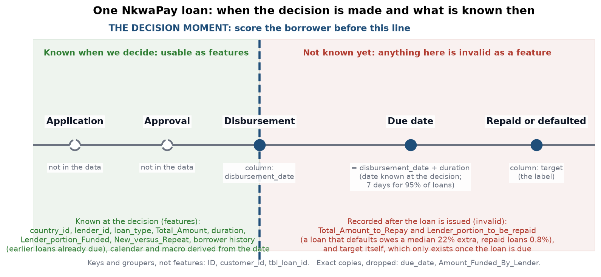

# Part A — Problem Framing, Loan Timeline, Label, Feature Audit & Leakage Rulings (#9)

This document records the team's confirmed Part A rulings (following the agenda in [PART_A_SESSION.md](PART_A_SESSION.md)) so every model, audit, and report section rests on one agreed specification. All draft Part A decisions (**D-2** through **D-7**, **D-13**, **D-14**, and **D-18**) are now marked `decided` in [DECISIONS.md](DECISIONS.md).

---

## 1. Loan Timeline and Decision Moment

*Generated by `python -m scripts.make_timeline_figure`. The raw data contains no application timestamp and no approval timestamp, so `disbursement_date` is the closest available column to the lending decision.*

- **When NkwaPay decides:** At loan application, before any money is disbursed.
- **Closest column in `Train.csv` / `Test.csv`:** `disbursement_date` (for mobile-money micro-loans, disbursement occurs immediately after approval).
- **Strict leakage rule:** Any feature available **before or at** `disbursement_date` is valid; anything recorded or derived **after** disbursement (especially after default or repayment) is invalid and must be excluded.
- **When an outcome becomes known (D-13):** A loan's repayment outcome (`target`) is not known until its `due_date` (`disbursement_date + duration`, verified exact on 100% of rows). Therefore, borrower history features (`n_past_labelled`, `n_past_defaults`, `past_default_rate`, `days_since_last_default`) only count earlier loans whose **`due_date` is strictly before** the current loan's `disbursement_date`. Activity counts (`n_past_loans`, `days_since_last_loan`) use a backward `merge_asof` with `allow_exact_matches=False` so only strictly earlier disbursements are included. This is brute-force verified on 400 random rows inside `src/features.py::validate()`.

---

## 2. Label Definition, Time Window, and Selective-Label Limitation

- **Label (`target`):** Binary lender-recorded outcome where `1 = defaulted` and `0 = repaid`.
- **Coverage & time window:** `Train.csv` contains **68,654 lender-loan rows** (66,520 unique loans across 6,540 customers) in **Kenya only**, disbursed between **2021-10-04 and 2024-11-14**. Overall default rate is **1.83%** (1,258 defaults), shifting sharply across years: **53.8%** in 2021 (`n = 39`), **1.3%** in 2022 (`n = 64,405`), **11.5%** in 2023 (`n = 1,240`), and **8.7%** in 2024 (`n = 2,970`).
- **Unlabelled deployment target:** `Test.csv` contains **15,069 Kenyan rows** (Nov 2021 – Nov 2024) and **3,525 Ghanaian rows** (Nov 2021 – Mar 2023; 446 customers, 0 overlap with Train) with **no labels**.
- **Selective-label / reject-inference limitation (D-14):** Outcomes exist only for borrowers previously approved by lenders, and defaulters are cut off from future borrowing (only **3.5%** of the 1,016 customers who defaulted ever received another loan; only 152 rows have a known past default). Models learn default risk conditional on past approval, not on the full Ghanaian applicant population; this limitation is carried directly into the fairness audit ([docs/audit/audit.md](audit/audit.md)) and Ghana pilot plan ([docs/audit/ghana_trust.md](audit/ghana_trust.md)).

---

## 3. Feature Audit and Confirmed Leakage Rulings

Every column of `Train.csv` (all 16 raw columns) and every engineered feature in `src/features.py` is audited row-by-row in **[docs/feature_audit.md](feature_audit.md)** (now confirmed `decided`). The table below records the confirmed rulings in [DECISIONS.md](DECISIONS.md):

| ID | Question | Confirmed Ruling | Key Evidence & Caveats |
| --- | --- | --- | --- |
| **D-2** | Are `Total_Amount_to_Repay` and `Lender_portion_to_be_repaid` leaks? | **Drop both** (`config.LEAKY_COLUMNS`) | Markup over principal has univariate AUC **0.981** (`Lender_portion_to_be_repaid / funded` = **0.980**); repaid loans owe a median **0.76%** extra vs **22.1%** for defaults (`reports/EDA_REPORT.md` §5, `eda_leakage_univariate_auc.png`, `eda_markup_by_outcome.png`). *Caveat:* `VariableDefinitions.txt` labels them "expected", so this is an empirical data ruling rather than proof; keeping them makes every score near-perfect and unusable at decision time. |
| **D-3** | Two-lender loans (2,134 repeated `tbl_loan_id`) | **Keep rows; group by loan/customer in every split** | Same borrower, amount, and disbursement date; labels agree on 2,132 of 2,134 loans (99.9%). *Caveat:* the raw 8.3% vs 1.4% default gap is largely a timing effect (two-lender loans are 0.9% of 2022 loans vs 46% in 2023 and 64% in 2024; `01_eda.ipynb` §6) and is not used as a rationale for the decision. |
| **D-4** | 4,306 shared customers & 920 shared loans across Train/Test | **Keep in Train; fold by `customer_id`; never validate across sibling rows** | The 920 shared `tbl_loan_id` rows are the sibling lender's share of two-lender loans (labels agree 99.9%), not duplicate records (`01_eda.ipynb` §2). |
| **D-5** | Unseen lenders & loan types in Test (Ghana) | **One-hot with `handle_unknown="ignore"`** + review flag | 96.7% of Ghana rows use an unseen lender (4 new lenders) and 87.3% an unseen `loan_type` (`Type_3`, `Type_8`); implemented in `src/processing/preprocess.py` and flagged via `needs_review` in `src/serving/scorer.py`. |
| **D-6** | Currency unit across Kenya (KES) & Ghana (GHS) | **Convert amounts to USD via previous-year FX (`log_amount_usd`)** | Keeps Kenya and Ghana on a shared scale for Task 1 and Task 2; local currency is converted back in the scorer and used for the cost matrix. |
| **D-7** | Validation scheme to trust | **Compare on `fold_group`; quote `temporal` (2023+) as the honest forecast** | Random `fold_strat` inflates tree PR-AUC (LightGBM 0.303 vs 0.195 by customer vs 0.148 by time); `temporal` (train < 2023, test 2023+) exposes regime drift (ROC-AUC 0.56–0.65). |
| **D-13** | When is a past default known? | **Only when earlier `due_date < disbursement_date`** | Prevents outcome leakage into history features; enforced and tested in `src/features.py::validate()`. |
| **D-14** | Selective labels (defaulters cut off) | **Stated limitation across report & audit** | Only 3.5% of defaulters borrow again; documented in Part A, Model Card, Datasheet, and Ghana pilot plan. |
| **D-18** | Macro columns & `log_amount_local` as model inputs; Task 1 unit | **Exclude macro & `log_amount_local` from model inputs; Task 1 predicts log USD** | Kenya-only training gives each macro column only 4 yearly values (acting as year/country markers; Ghana inflation 31–38% sits far outside Kenya's 5–8%); removing macro raised MLP temporal ROC-AUC 0.48 → 0.65 and prevents wild Ghana extrapolation. Confirmed by #52 ablation (`reports/tables/ablation.csv`). |

---

## 4. Two ML Tasks, Business Goal, and Cost Matrix

- **Task 1 (Loan-limit regression):** Predict `log1p(Total_Amount_USD)` without using amount features (`NUM_FEATURES_T1`). Evaluated on both log and original USD scales (`notebooks/03_regression.ipynb`). Deployed as an **85th-quantile LightGBM cap** (`lightgbm_reg_q85`, **D-30**) so only extreme outlier requests are trimmed (Kenya Test cut rate drops from 48.9% under mean regression to **14.6%**).
- **Task 2 (Default probability classification):** Predict calibrated `P(target = 1)` at disbursement (`notebooks/02_classification.ipynb`). Deployed using **Platt-calibrated logistic regression** (`logreg`, **D-29**) for strongest temporal stability (2023+ ROC-AUC 0.633), fast exact log-odds reason codes (~21 ms median), and fairness-audit alignment (**D-25**).
- **Business goal & Ghana cedi cost matrix (D-22, D-28, D-26):** Measured from Ghana's Test loans (median principal **GHS 3,002**, 7-day fee **3.0%**, 20% recovery, GHS 14.8 collection cost, 3 future loans lost per wrongly declined good borrower):
  - False-positive cost `C_FP = GHS 270`, false-negative cost `C_FN = GHS 2,416` → decline threshold **`p* = C_FP / (C_FP + C_FN) = 0.1006` (~10%)**.
  - First-time borrowers with `0.10 < p <= 0.30` receive a **25% starter loan** (**D-26**), lifting first-time approval from **49% → 81%** at a net cost of **GHS 18 per first-time applicant**.
  - All Ghanaian applications carry `needs_review = True` until a labelled local pilot validates calibration (**D-24**, **D-27**).
