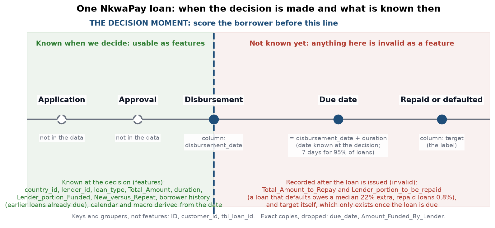
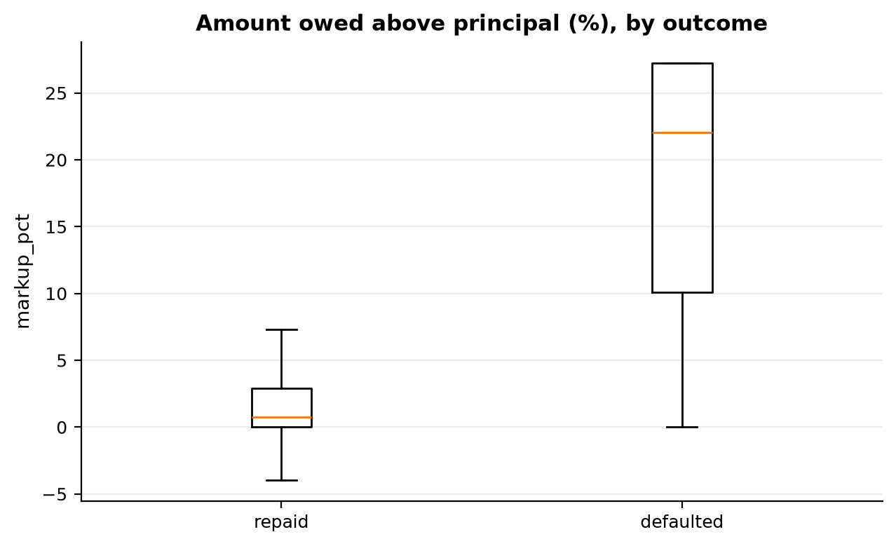
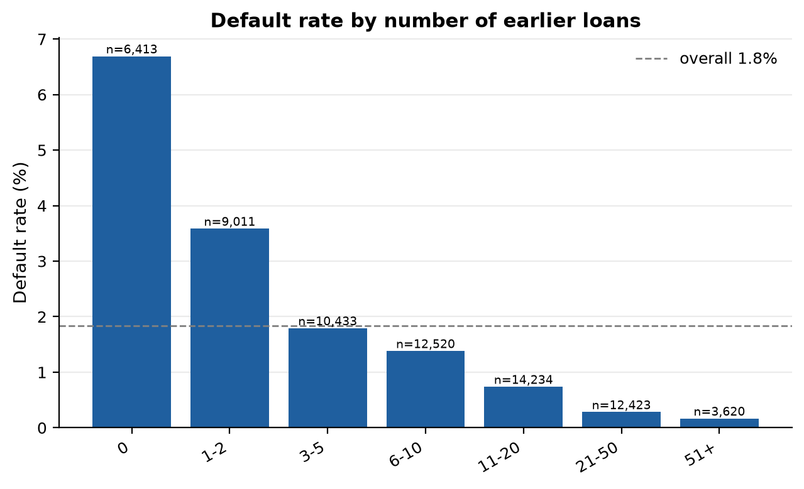
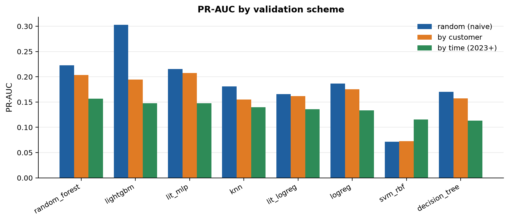

# Data, leakage audit, features and validation (P1 section of the technical report)

*Draft section for issue #34. Author: Perfect Elorm Avugla (P1). Every number is traced to a file in the sources list at the end. Figures live in `reports/figures/`.*

## 1. The data and the decision it supports

NkwaPay lends small, short mobile-money loans and must decide, for each application, whether to lend and how much. We use three sources: the Zindi African Credit Scoring files (`Train.csv`, `Test.csv`, FRED macro indicators by country and year) and the World Bank Global Findex 2021 microdata for Ghana.

`Train.csv` holds **68,654 rows, covering 66,520 loans and 6,540 customers**, all from **Kenya**, disbursed October 2021 to November 2024. `Test.csv` holds 18,594 rows: 15,069 from Kenya and **3,525 from Ghana, with no labels**. A row is one *lender's share* of a loan: 2,134 loans are funded by two lenders and appear twice, with the same borrower, amount and date, and with the same label in 99.9% of cases. We therefore treat the **loan, not the row**, as the unit when we split data.

**Two tasks use the same inputs.** Task 1 (regression) predicts the loan amount to approve, `Total_Amount`, modelled in USD on a log scale so that Kenyan and Ghanaian limits share a unit. Task 2 (classification) predicts `target`, where 1 means the borrower defaulted. Only **1.83% of rows (1,258) default**, so accuracy is meaningless: a model that predicts "repays" for everyone is 98% accurate and finds no defaulters. We judge Task 2 by PR-AUC, whose no-skill value equals the default rate, and by ROC-AUC, calibration and the money lost at a cost-based threshold.

**Label.** `target` is the lender's recorded outcome for loans disbursed between October 2021 and November 2024. An outcome only exists once a loan is due. Labels exist only for **approved** borrowers.

*Figure 1. The decision is made at disbursement. The data has no application or approval date, so `disbursement_date` is the closest column to that moment. Everything recorded after it is invalid as a feature.*

## 2. Leakage audit

We audited all 16 columns of `Train.csv` (`docs/feature_audit.md`), asking of each: is it known at the decision moment? Two columns fail. `Total_Amount_to_Repay` and `Lender_portion_to_be_repaid` record what is owed on a loan. Their **ratio to the principal** separates defaulters from repayers almost perfectly: a univariate AUC of **0.98**, against 0.62 to 0.70 for the columns taken on their own. Repaid loans owe a median **0.76%** above principal, following a fee schedule by term; defaulted loans owe a median **22.1%**, which looks like penalties added after default. A model given these columns would score near-perfectly and be useless at decision time, so both are **dropped**.

*Figure 2. Repaid loans owe a small fee; defaulted loans owe far more.*

**Caveat.** The data owner's variable definitions describe `Total_Amount_to_Repay` as the amount "expected" to be repaid, which would make it known at issuance. The data say otherwise, but we cannot prove which is true. We chose to drop the columns, and the team's decision record (D-2) states this as a judgement from the data, not a proof. Two further columns, `due_date` and `Amount_Funded_By_Lender`, are valid but exact functions of other columns on 100% of rows, so they are dropped as redundant.

## 3. Time-safe features

Past behaviour is the strongest signal we have. The default rate falls from **6.7% for borrowers with no earlier loan to 0.17% for those with 51 or more** (Figure 3). It must be built without leaking the future, and the main hazard is the label itself: a loan's outcome does not exist until its due date. We therefore count an earlier loan's default only if its **due date is before the current loan's disbursement** (decision D-13), using a backward `merge_asof` with no exact matches. Two-lender loans count once. The history features are the number of earlier loans, days since the last loan, the number of earlier loans with a known outcome, earlier defaults, their rate, and days since the last default.

We do not trust this by inspection. `src/features.py` recomputes the history features by brute force on 400 random rows, straight from the raw files, and fails if any value differs. We also confirmed the check works by deliberately breaking the feature code in two ways (allowing exact-date matches, and counting outcomes before the due date) and observing it fail each time.

*Figure 3. Experienced borrowers almost never default; first-time borrowers default at about 7%.*

The remaining inputs are loan facts known at disbursement (term, the lender's funded share, whether the borrower is new, the number of lenders, lender and product category) and calendar features from the disbursement date. Amounts are log-transformed because the distribution is extremely right-skewed (skew 103.8 on the raw scale, 0.14 after `log1p`; median 5,249, mean 14,837, maximum 23 million KES). The final model inputs are **14 numeric features plus `lender_id` and `loan_type`** (`src/config.py`). Country-level macro indicators and the local-currency amount stay in the feature file for the Ghana study but are not model inputs (D-18): with Kenya-only training each macro column takes only four yearly values, so it acts as a year marker, and Ghana's inflation (31 to 38%) lies far outside Kenya's (5 to 8%).

## 4. Validating without leakage

Customers borrow repeatedly (median 6 loans, up to 208), so one customer's rows are strongly correlated and a random split lets a model memorise people. We compare three schemes on the same models:

1. **Stratified k-fold** (random rows): the naive baseline.
2. **GroupKFold by customer** (5 folds): no customer, and therefore no loan, appears on both sides. This is our comparison scheme. Fold default rates range from 1.66% to 1.97%.
3. **Temporal split**: train on loans disbursed before 1 January 2023 (64,444 rows, 857 defaults) and validate on 2023 onwards (4,210 rows, 401 defaults, **9.5%**). This is the honest forecast for future loans (D-7).

| Model | Random: ROC / PR | By customer: ROC / PR | By time: ROC / PR |
| --- | :---: | :---: | :---: |
| Majority baseline | 0.500 / 0.018 | 0.500 / 0.018 | 0.500 / 0.095 |
| Logistic regression | 0.849 / 0.186 | 0.843 / 0.175 | 0.633 / 0.134 |
| LightGBM | 0.882 / 0.303 | 0.849 / 0.195 | 0.582 / 0.148 |
| Random forest | 0.884 / 0.223 | 0.871 / 0.204 | 0.619 / 0.157 |
| MLP | 0.868 / 0.215 | 0.868 / 0.207 | 0.648 / 0.148 |

*Figure 4. Random validation inflates flexible models; validation by time exposes drift.*

**How much was the naive score inflated?** Random folds overstate **LightGBM's PR-AUC by 55%** (0.303 against 0.195 by customer) because a flexible model memorises customers; the less flexible logistic regression is barely affected (0.186 against 0.175). The inflation grows with model flexibility, which is the reason to group by customer.

**By time, every model falls much further:** ROC-AUC drops to between 0.56 and 0.65. The population changed: the default rate rose from about 1.3% before 2023 to 9.5% after, lender mix shifted, and newer loans carry less borrower history. Read by-time PR-AUC against its own no-skill floor of **0.095**, not 0.018. We therefore compare models by customer but quote the by-time score as what to expect on future loans.

## 5. Baseline, k-nearest neighbours and SVM

The brief requires at least five models, including a majority baseline. We contribute three. The **majority baseline** reaches PR-AUC 0.018, the floor every model must clear. **k-nearest neighbours** (k = 25, distance-weighted) reaches PR-AUC 0.155 (95% interval 0.134 to 0.180) and ROC-AUC 0.769 by customer. A **kernel SVM** (RBF, balanced class weights, Platt scaling; derivation in Appendix) reaches ROC-AUC 0.805 but PR-AUC only 0.073 (interval 0.065 to 0.081), less than half of kNN's, so it ranks the bulk of loans well but puts too many repayers at the top. It was fitted on a **12,000-row subsample**, because a kernel SVM needs an n × n matrix and each training fold has about 55,000 loans; the subsample leaves only about 220 defaulters. That this explains the weak PR-AUC is a hypothesis we did not test. By time, kNN and the SVM reach ROC-AUC 0.600 and 0.570, so neither is a candidate for deployment.

## 6. Limitations

- **Selective labels.** Only 3.5% of customers who defaulted (36 of 1,016) ever received another loan, so outcomes exist only for people NkwaPay already approved. Our model learns who defaults *among those previously approved*, not among all applicants, and may be miscalibrated for people the old process would have declined.
- **No Ghana labels.** Ghana's 3,525 test rows are unlabelled and unlike Kenya's: the median loan is USD 494 against 47, the mean term 36 days against 9, 96.7% of rows use a lender and 87.3% a loan type never seen in training, and no Ghanaian customer appears in `Train.csv`. Our scores there are unvalidated, which is why the scorer flags such cases for review.
- **Small by-time validation set.** The honest forecast rests on 4,210 rows and 401 defaults.
- **Judgement on two columns.** See the caveat in section 2.

## Sources

- Counts, default rates, leakage AUCs, markup medians, skew, Ghana comparison: `reports/EDA_REPORT.md` §1, 3, 4, 5, 8 and `reports/tables/eda_*.csv`; skew and counts re-derived from the raw files in `notebooks/01_eda.ipynb` §6.
- Two-lender loans, label agreement, 3.5% cut-off: `notebooks/01_eda.ipynb` §1 and §5; `docs/DECISIONS.md` D-3, D-13, D-14.
- Feature list, model inputs, fold and temporal sizes: `src/features.py`, `src/config.py`, `docs/DECISIONS.md` D-7, D-18.
- Model scores by validation scheme: `reports/tables/task2_model_summary.csv`; intervals: `reports/tables/task2_bootstrap_ci.csv`.
- Brute-force check of the history features: `src/features.py` `validate()`. The two deliberate-bug runs were repeated on 2026-11-19 on the full feature build and are recorded in `docs/WORKLOG.md`.
- Drift after 2023 (lender mix, less borrower history, 9.5% vs 1.3% default rate): `docs/learning/P2_learning_report.md`, and Bernard's target EDA (`reports/tables/eda_target_shift_2023_*.csv`).
- SVM derivation: `docs/derivations/svm.md`; kNN, SVM and baseline explanation: `docs/learning/P1_models_explained.md`.
