# Exploratory data analysis

Generated by `python -m scripts.make_eda_report` from `data/raw/` and `data/processed/features.parquet`; do not edit by hand. Figures are in `reports/figures/eda_*.png`, tables in `reports/tables/eda_*.csv`. Each section states the question, the evidence, what it shows, and the decision in [DECISIONS](../docs/DECISIONS.md) it supports.

## 1. What data do we have?

**Question:** How many rows, loans and customers, over which dates, in which country?

| split | country_id | rows | loans | customers | first_loan | last_loan | default_rate |
| --- | --- | --- | --- | --- | --- | --- | --- |
| test | Ghana | 3,525 | 2,084 | 446 | 2021-11-30 | 2023-03-21 |  |
| test | Kenya | 15,069 | 14,983 | 4,516 | 2021-11-08 | 2024-11-14 |  |
| train | Kenya | 68,654 | 66,520 | 6,540 | 2021-10-04 | 2024-11-14 | 0.018 |

| split | missing_cells | duplicate_rows | duplicate_ids | due_eq_disb_plus_duration | funded_eq_amount_x_portion | zero_amount_funded |
| --- | --- | --- | --- | --- | --- | --- |
| train | 0 | 0 | 0 | 1.000 | 1.000 | 8,520 |
| test | 0 | 0 | 0 | 1.000 | 1.000 | 1,868 |

**What it shows:**
- Train is **Kenya only**: 68,654 rows, 6,540 customers, Oct 2021 to Nov 2024. Test adds 3,525 Ghanaian rows with no labels.
- No missing cells and no duplicate rows or IDs in either file; `due_date` = disbursement + duration and `Amount_Funded_By_Lender` = amount x portion on 100% of rows.

**Decision it supports:** drop `due_date` and `Amount_Funded_By_Lender` as exact copies of other columns; no imputation needed for raw columns.

## 2. What is one row?

**Question:** Is a row a loan, and how often do customers borrow?

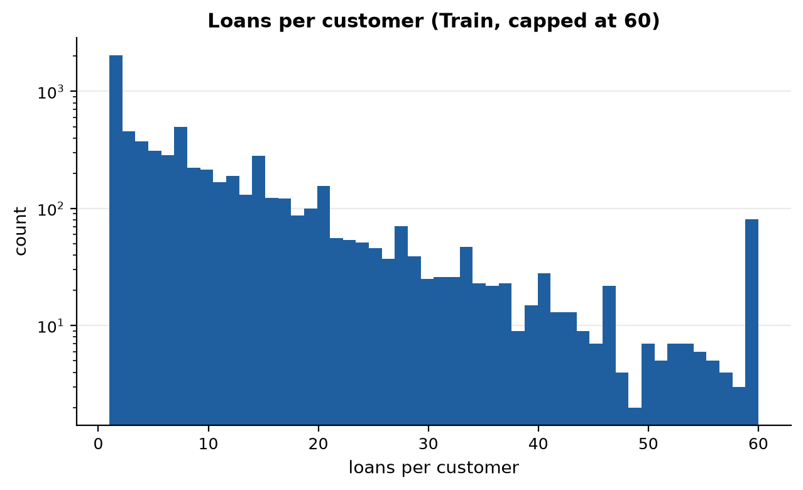
*Most customers borrow repeatedly: median 6 loans, up to 208.*

**What it shows:**
- A row is one **lender's share** of a loan: 2,134 of 66,520 loans appear twice (two lenders), and their labels agree 99.9% of the time.
- Two-lender loans default far more (8.3% vs 1.4%).
- Customers take a median of 6 loans (mean 10.2, max 208), so one customer's rows are strongly correlated.

**Decision it supports:** group every split and every bootstrap by customer (D-3, D-4); add `n_lenders_on_loan` as a feature.

## 3. How rare is default, and does it move?

**Question:** What is the default rate, and how does it change over time, lender, product and tenure?

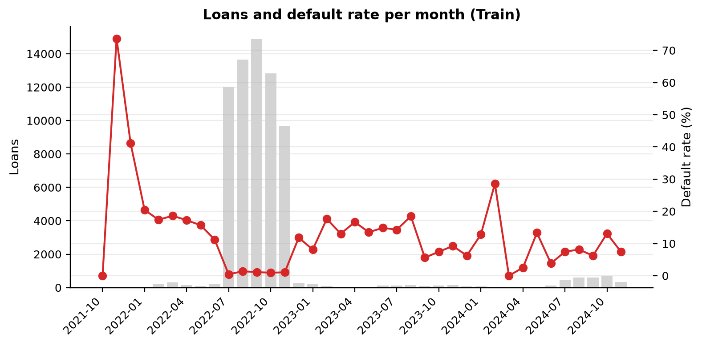
*Default rate jumps from about 1% in 2022 to 10% from 2023, while volume falls.*

| year | loans | defaults | default_rate |
| --- | --- | --- | --- |
| 2,021 | 39 | 21 | 0.538 |
| 2,022 | 64,405 | 836 | 0.013 |
| 2,023 | 1,240 | 143 | 0.115 |
| 2,024 | 2,970 | 258 | 0.087 |

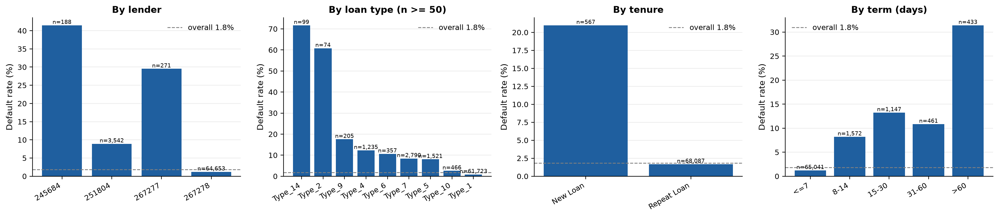
*Default rate by lender, product, tenure and term: risk is concentrated in small groups.*

| column | value | loans | defaults | default_rate |
| --- | --- | --- | --- | --- |
| lender_id | 245684 | 188 | 78 | 0.415 |
| lender_id | 251804 | 3,542 | 316 | 0.089 |
| lender_id | 267277 | 271 | 80 | 0.295 |
| lender_id | 267278 | 64,653 | 784 | 0.012 |
| tenure | New Loan | 567 | 119 | 0.210 |
| tenure | Repeat Loan | 68,087 | 1,139 | 0.017 |
| term | <=7 | 65,041 | 791 | 0.012 |
| term | 8-14 | 1,572 | 129 | 0.082 |
| term | 15-30 | 1,147 | 152 | 0.133 |
| term | 31-60 | 461 | 50 | 0.108 |
| term | >60 | 433 | 136 | 0.314 |

**What it shows:**
- Only **1.83%** of rows default (1,258 of 68,654): accuracy is meaningless; use PR-AUC.
- By year: 2021 53.8% (n=39), 2022 1.3% (n=64,405), 2023 11.5% (n=1,240), 2024 8.7% (n=2,970).
- Lenders range from 1.2% to 41.5%; new borrowers default at 21.0% vs 1.7% for repeat borrowers.
- Longer terms are riskier: 1.2% for 7-day loans vs 31.4% above 60 days.

**Decision it supports:** class weights in every model (`configs/models.yaml`), PR-AUC as headline metric, and a **temporal** validation split (D-7) because the rate drifts.

## 4. How are amounts distributed?

**Question:** Why log-transform, and does loan size relate to risk?

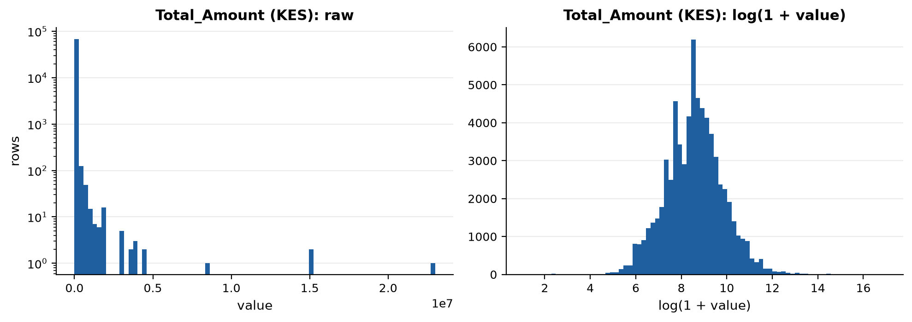
*Amounts span 2 to 23 million KES; on the log scale they are close to bell-shaped.*

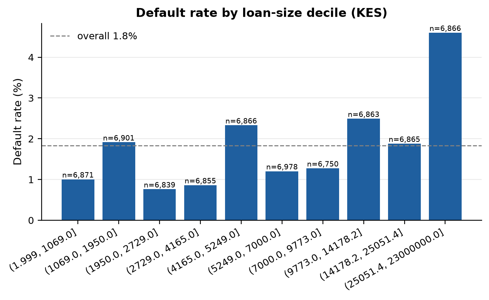
*The largest 10% of loans default at about 2.5 times the average rate.*

| amount_decile | loans | defaults | default_rate |
| --- | --- | --- | --- |
| (1.999, 1069.0] | 6,871 | 69 | 0.010 |
| (1069.0, 1950.0] | 6,901 | 132 | 0.019 |
| (1950.0, 2729.0] | 6,839 | 52 | 0.008 |
| (2729.0, 4165.0] | 6,855 | 59 | 0.009 |
| (4165.0, 5249.0] | 6,866 | 160 | 0.023 |
| (5249.0, 7000.0] | 6,978 | 84 | 0.012 |
| (7000.0, 9773.0] | 6,750 | 86 | 0.013 |
| (9773.0, 14178.2] | 6,863 | 171 | 0.025 |
| (14178.2, 25051.4] | 6,865 | 129 | 0.019 |
| (25051.4, 23000000.0] | 6,866 | 316 | 0.046 |

**What it shows:**
- Median loan 5,249 KES, mean 14,837, max 23,000,000: the mean is pulled up by a few huge loans.
- Risk rises in the top decile (4.6%) but is not monotone below it.

**Decision it supports:** log1p on every money column and on the Task 1 target; report Task 1 errors on both scales; amount in USD so Kenya and Ghana share a unit (D-6, D-18).

## 5. Which columns leak the answer?

**Question:** Is any column recorded after the lending decision?

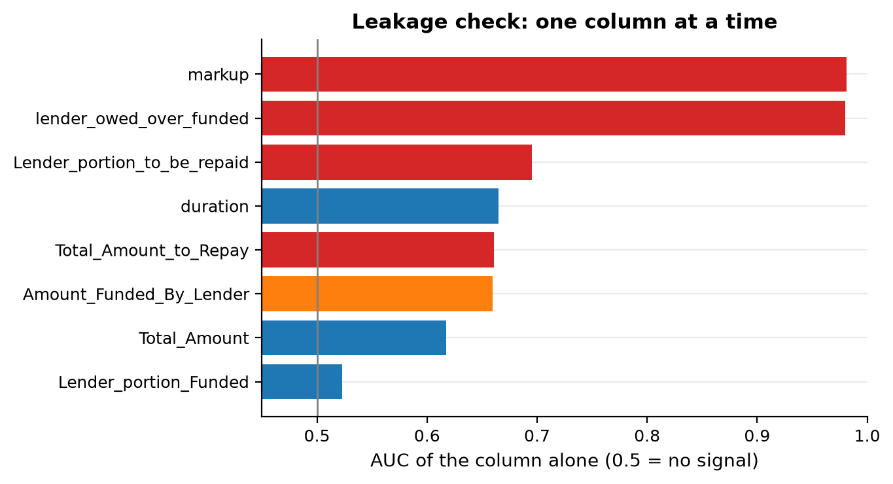
*The repayment markup alone separates defaulters at AUC 0.98: it records the outcome.*

| column | auc | verdict |
| --- | --- | --- |
| markup | 0.981 | leak: repay / principal - 1 (D-2) |
| lender_owed_over_funded | 0.980 | leak: lender owed / funded (D-2) |
| Lender_portion_to_be_repaid | 0.695 | dropped: its ratio to funded leaks (D-2) |
| duration | 0.665 | kept |
| Total_Amount_to_Repay | 0.661 | dropped: its ratio to principal leaks (D-2) |
| Amount_Funded_By_Lender | 0.659 | dropped: = amount x portion (redundant) |
| Total_Amount | 0.618 | kept (log, USD); Task 1 target |
| Lender_portion_Funded | 0.523 | kept |

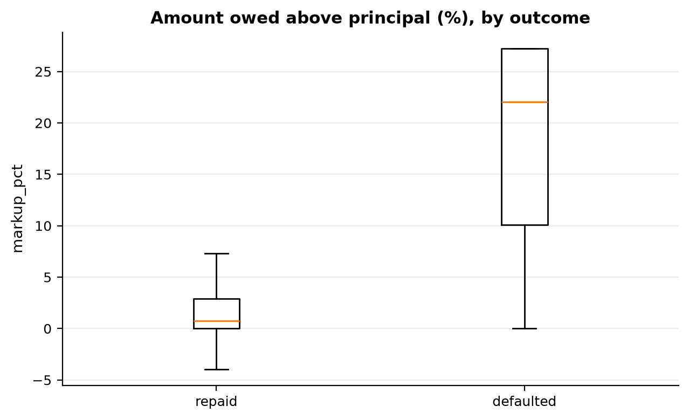
*Repaid loans owe a small fee; defaulted loans owe much more, consistent with penalties added after default.*

| outcome | count | 25% | 50% | 75% | mean |
| --- | --- | --- | --- | --- | --- |
| defaulted | 1,258.00 | 10.08 | 22.06 | 41.69 | 28.15 |
| repaid | 67,396.00 | 0.00 | 0.76 | 2.92 | 1.68 |

**What it shows:**
- Repaid loans owe a median 0.76% above principal; defaulted loans 22.1%.
- The two repayment columns on their own score only about 0.66-0.70; it is their **ratio to the principal** that reaches 0.98.

**Decision it supports:** drop `Total_Amount_to_Repay` and `Lender_portion_to_be_repaid` (D-2); keep the measured fee only for the cost matrix (D-19).

## 6. Does borrower history carry signal?

**Question:** Do the time-safe history features separate risk, and where are they empty?

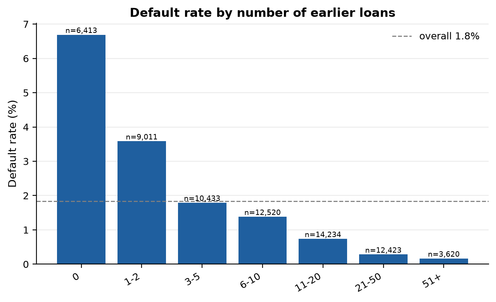
*Experienced borrowers almost never default; first-time borrowers default at about 7%.*

| past_loans | loans | defaults | default_rate |
| --- | --- | --- | --- |
| 0 | 6,413 | 429.000 | 0.067 |
| 1-2 | 9,011 | 323.000 | 0.036 |
| 3-5 | 10,433 | 187.000 | 0.018 |
| 6-10 | 12,520 | 173.000 | 0.014 |
| 11-20 | 14,234 | 105.000 | 0.007 |
| 21-50 | 12,423 | 35.000 | 0.003 |
| 51+ | 3,620 | 6.000 | 0.002 |

| group | days_since_last_loan | past_default_rate | days_since_last_default |
| --- | --- | --- | --- |
| test Ghana | 0.188 | 1.000 | 1.000 |
| test Kenya | 0.091 | 0.174 | 0.998 |
| train Kenya | 0.093 | 0.175 | 0.998 |

**What it shows:**
- Default rate falls from 6.7% with no earlier loans to 0.17% after 50+.
- Only 3.4% of the 1,016 customers who defaulted ever got another loan: defaulters are cut off, so `past_default_rate` is almost always 0 or empty and the labels only cover approved borrowers.
- Every Ghana row has an empty default history (no Ghana customer appears in Train).

**Decision it supports:** keep history features with missing-indicators (D-13); state the reject-inference limitation (D-14) and the Ghana history gap in Part C.

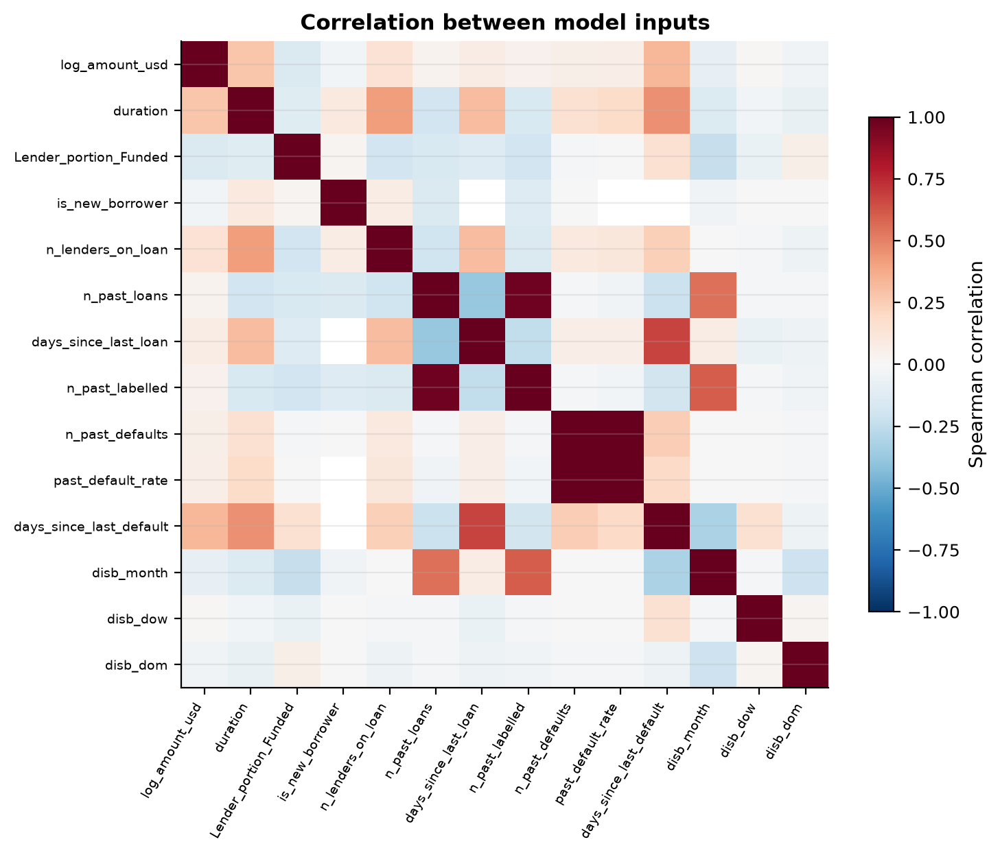
*Spearman correlation between model inputs: history counts move together; no input is a copy of another.*

## 7. How many categories, and which are new in Test?

**Question:** Can one-hot encoding handle lenders and loan types?

| column | n_train | n_test | top_value | top_share | unseen_in_test | test_rows_unseen |
| --- | --- | --- | --- | --- | --- | --- |
| lender_id | 4 | 8 | 267278 | 0.942 | 296540, 296542, 297182, 297183 | 0.183 |
| loan_type | 22 | 22 | Type_1 | 0.899 | Type_3, Type_8 | 0.165 |
| New_versus_Repeat | 2 | 2 | Repeat Loan | 0.992 | - | 0.000 |
| country_id | 1 | 2 | Kenya | 1.000 | Ghana | 0.190 |

**What it shows:**
- `lender_id` has 4 values in Train (one holds 94.2%); Test adds 4 unseen lenders.
- `loan_type` has 22 values (Type_1 is 89.9%); Test adds Type_3, Type_8.

**Decision it supports:** one-hot with `handle_unknown='ignore'` (D-5); the scorer flags unseen lenders and products for human review.

## 8. Is Ghana like Kenya?

**Question:** How different is the population the model will be used on?

| measure | Test Ghana | Test Kenya | Train (Kenya) |
| --- | --- | --- | --- |
| rows | 3,525.000 | 15,069.000 | 68,654.000 |
| median_amount_usd | 494.399 | 46.188 | 47.411 |
| share_7_day | 0.862 | 0.951 | 0.946 |
| mean_duration_days | 35.938 | 8.289 | 8.545 |
| share_new_borrower | 0.018 | 0.007 | 0.008 |
| median_past_loans | 5.000 | 9.000 | 9.000 |
| share_no_labelled_history | 1.000 | 0.174 | 0.175 |
| share_unseen_lender | 0.967 | 0.000 | 0.000 |
| share_unseen_loan_type | 0.873 | 0.000 | 0.000 |

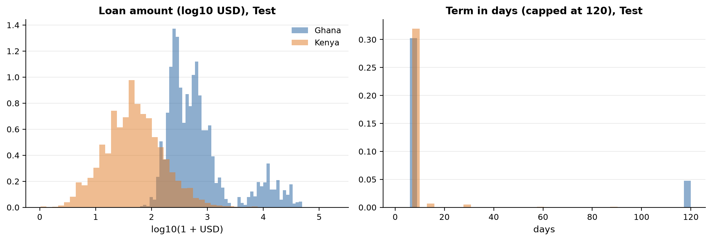
*Ghanaian loans are about 10 times larger in USD and four times longer.*

**What it shows:**
- Median loan: USD 494 in Ghana vs 47 in Kenya; mean term 36 vs 9 days.
- 96.7% of Ghana rows use a lender and 87.3% a product never seen in Train; 0 Ghana customers appear in Train.
- Kenya Test overlaps Train: 4,306 shared customers and 920 sibling lender rows.

**Decision it supports:** treat Ghana scores as unvalidated: the scorer sets `needs_review`, and Part C must recommend a labelled pilot before automation.

## 9. What do the macro indicators add?

**Question:** Can country-level economics be model inputs?

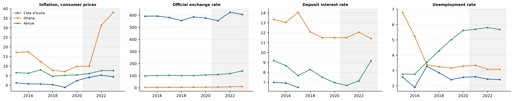
*Ghana's inflation (31-38%) and exchange rate (8-11 GHS/USD) sit far outside anything in Kenya's training years.*

**What it shows:**
- Kenya's inflation over the training years ranges 5.4-7.7%; Ghana's 9.9-38.1%.
- With Kenya-only training, each macro column takes four yearly values: it acts as a year marker and cannot teach an economic effect.

**Decision it supports:** macro columns stay in the feature file for the shift study but are not model inputs (D-18).

## 10. Who in Ghana lacks access to credit? (Findex 2021)

**Question:** Which groups the model can never see, because they do not borrow digitally?

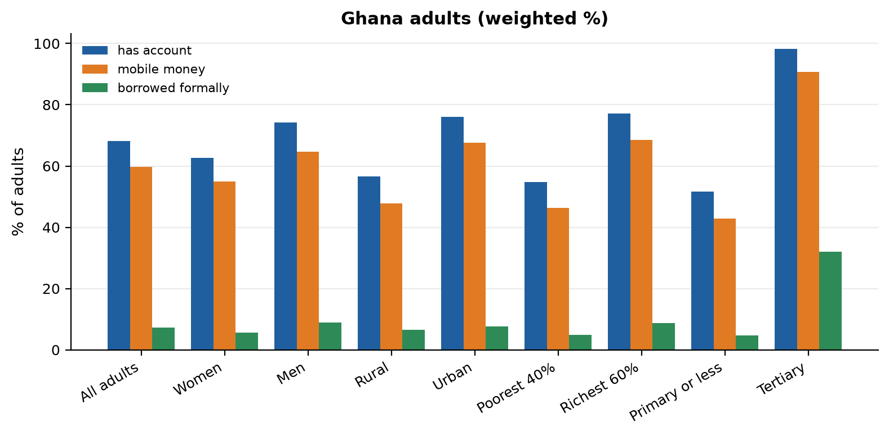
*Women, rural, poorer and less-educated adults are less likely to hold accounts or borrow formally.*

| group | n | has_account | mobile_money | borrowed_formally | borrowed_any |
| --- | --- | --- | --- | --- | --- |
| All adults | 1,000 | 68.2 | 59.7 | 7.2 | 52.2 |
| Women | 465 | 62.6 | 55.0 | 5.6 | 47.9 |
| Men | 535 | 74.2 | 64.6 | 9.0 | 56.7 |
| Rural | 360 | 56.5 | 47.9 | 6.6 | 52.0 |
| Urban | 640 | 76.1 | 67.6 | 7.7 | 52.4 |
| Poorest 40% | 309 | 54.7 | 46.4 | 4.9 | 52.1 |
| Richest 60% | 691 | 77.2 | 68.5 | 8.8 | 52.3 |
| Primary or less | 295 | 51.6 | 42.9 | 4.7 | 50.3 |
| Tertiary | 64 | 98.3 | 90.7 | 32.0 | 62.0 |

**What it shows:**
- Only 7.2% of Ghanaian adults borrowed formally; women 5.6% vs men 9.0%.
- Accounts: rural 57% vs urban 76%; poorest 40% 55% vs richest 60% 77%.

**Decision it supports:** the loan data has no gender or region, so Part D uses Findex to say who the model cannot see; a model trained on existing borrowers can widen the gap.
